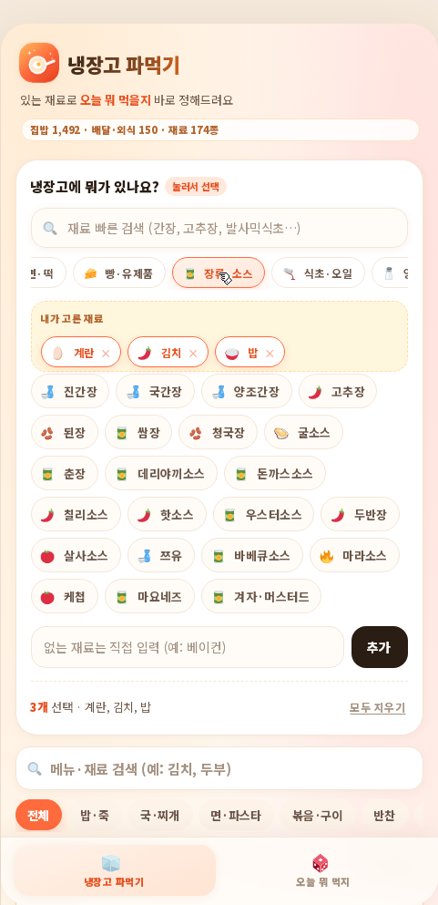
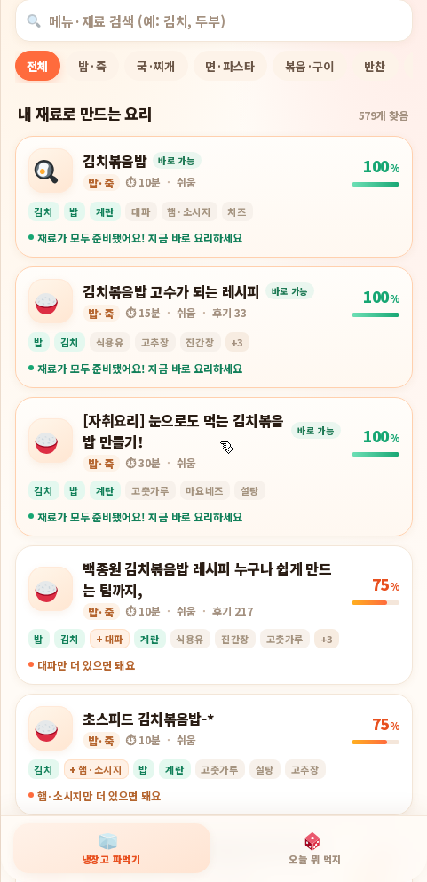
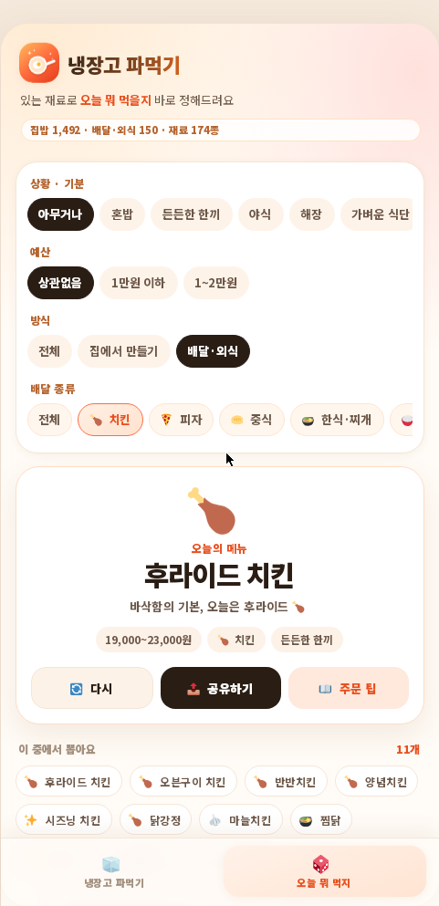

# 🍳 냉장고 파먹기 · 오늘 뭐 먹지

냉장고에 있는 재료만 골라도 **지금 만들 수 있는 요리**를 찾아주고,
오늘 뭐 먹을지 못 정했을 때는 **룰렛**으로 메뉴를 정해주는 모바일 웹앱입니다.

👉 **바로 쓰기: <https://chae7549-stack.github.io/what-to-eat-today/>**

<p align="center">
  
  
</p>
<p align="center">
  
  
</p>

- 설치 없이 브라우저에서 바로 열립니다.
- iPhone·Android 홈 화면에 추가하면 앱처럼 전체 화면으로 실행됩니다(PWA).
- **1,642가지 메뉴**(집밥 1,492 · 배달·외식 150) · **174가지 재료 분류(9개 그룹)** · 모든 메뉴에 **요리·주문 팁**
- 집밥 1,440여 가지는 **만개의레시피(10000recipe.com)** 에서 실제 레시피를 수집해 정리했습니다.
- 배달·외식 150개는 **배민 카테고리 14종**(치킨·피자·중식·한식찌개·덮밥·족발보쌈·일식돈까스·면국수·분식떡볶이·야식안주·패스트푸드·아시안·샐러드·카페디저트)으로 나누고 **2026년 예상 주문 가격 범위**를 붙였습니다.

---

## 주요 기능

### 🧊 1. 냉장고 파먹기 (재료 매칭)

- **174가지 재료 칩** — 채소·버섯 / 고기·해산물 / 계란·두부·콩 / 곡류·면·떡 / 빵·유제품 /
  **장류·소스(22종)** / **식초·오일(10종)** / **양념·향신(24종)** / 과일·기타의 **9개 그룹 탭**으로 나눠 골라요
  - 장류·소스: 진간장·국간장·양조간장·고추장·된장·쌈장·청국장·굴소스·춘장·데리야끼·돈까스소스·칠리소스·우스터·스리라차·쯔유·두반장·살사·마라소스·케첩·마요네즈·머스터드 …
  - 식초·오일: 양조식초·사과식초·현미식초·발사믹식초·레몬즙 / 식용유·올리브유·참기름·들기름·고추기름
  - 양념·향신: 고춧가루·설탕·올리고당·꿀·매실청·맛술·깨·다시다·치킨스톡·전분·베이킹파우더 …
- **재료 빠른 검색** — `냉장고에 뭐가 있나요?` 카드 안에서 "발사믹", "고추장"처럼 바로 찾아요
- 고른 재료는 카드 위 **`내가 고른 재료` 줄**에 모여 보여서, 그룹을 옮겨 다녀도 한눈에 확인·해제할 수 있어요

<p align="center"></p>
- 목록에 없는 재료는 **직접 입력**(예: 베이컨, 다진 마늘 → 자동으로 기존 재료와 연결)
- 보유 재료 기준 **매칭률(%)** 순으로 요리 정렬, `바로 가능` 배지 표시
- 부족한 재료를 `+ 대파`처럼 표시해서 **딱 무엇만 사면 되는지** 한눈에 보여요
- 요리를 누르면 **재료 체크리스트(분량 포함) + 단계별 조리법 + 요리 팁 + 원문 링크** 드로어가 열립니다
- 배달 메뉴를 누르면 **예상 주문 가격(2026년 서울 기준) · 배달 종류 · 예산대 · 주문 팁** 드로어가 열립니다
- 선택한 재료는 브라우저에 저장되어 다시 열어도 유지됩니다

### 🔍 1-1. 레시피 검색 · 카테고리

- **메뉴·재료 검색창**에서 "김치", "두부 김치"처럼 바로 찾을 수 있습니다 (1,492개도 즉시 검색)
- **카테고리 알약**: 전체 / 밥·죽 / 국·찌개 / 면·파스타 / 볶음·구이 / 반찬 / 전·부침 / 분식·야식 / 양식·기타
- 목록은 **24개씩 나눠 그려서**(`더 보기`) 아이폰 사파리에서도 스크롤이 가볍습니다

### 🎲 2. 오늘 뭐 먹지? (룰렛)

- 필터 4종
  - **상황·기분**: 아무거나 / 혼밥 / 든든한 한끼 / 야식 / 해장 / 가벼운 식단
  - **예산**: 상관없음 / 1만원 이하 / 1~2만원
  - **방식**: 전체 / 집에서 만들기 / 배달·외식
  - **집밥 종류**: 전체 / 밥·죽 / 국·찌개 / … / 양식·기타
  - **배달 종류**: 전체 / 🍗 치킨 / 🍕 피자 / 🥟 중식 / 🍲 한식·찌개 / 🍚 덮밥·비빔밥 / 🐷 족발·보쌈 /
    🍣 일식·돈까스 / 🍜 면·국수 / 🌶️ 분식·떡볶이 / 🍢 야식·안주 / 🍔 패스트푸드 / 🍜 아시안 / 🥗 샐러드·건강식 / ☕ 카페·디저트
- 배달 메뉴는 결과 카드에 **예상 가격**과 **주문 팁**(소스 따로, 사이즈, 세트가 저렴한지)까지 함께 나와요
- 필터에 맞는 후보만 남기고 **룰렛 애니메이션**으로 한 가지 메뉴를 뽑아줍니다
- 결과 카드에서 **다시 돌리기 · 공유하기 · 레시피(주문 팁)** 바로 실행
- 공유 문구 예시: `오늘 메뉴는 김치볶음밥 당첨! 🍳`

### 📤 공유

- **Web Share API** 우선 사용(아이폰·안드로이드 기본 공유 시트)
- 지원하지 않는 환경에서는 **클립보드 복사**로 자동 폴백

### 📱 PWA

- `manifest.webmanifest` + iOS 메타 태그(`apple-mobile-web-app-capable` 등)
- 마스커블 아이콘, 애플 터치 아이콘, SVG 파비콘 포함
- 서비스 워커(`sw.js`)로 앱 껍데기를 캐시 → **오프라인에서도 실행**

---

## 홈 화면에 추가하는 방법

| 기기 | 방법 |
| --- | --- |
| **iPhone (Safari)** | 공유 버튼 → **홈 화면에 추가** |
| **Android (Chrome)** | 우측 상단 ⋮ → **앱 설치** / **홈 화면에 추가** |
| **데스크톱 (Chrome/Edge)** | 주소창 오른쪽 설치 아이콘 |

설치하면 주소창 없이 전체 화면으로 열리고, 마지막에 보던 화면과 고른 재료가 그대로 남습니다.

---

## 파일 구조

```
what-to-eat-today/
├── index.html              # 화면 구조 (모드 1·2, 드로어, 광고 슬롯 주석)
├── styles.css              # 모바일 퍼스트 스타일 (480px 카드 레이아웃)
├── data/recipes-data.js    # 수집 레시피 1,440개 + 배달 메뉴 150개 + 재료 분류 174종 (자동 생성)
├── app.js                  # 큐레이션 요리 + 매칭/검색/룰렛/공유 로직
├── manifest.webmanifest    # PWA 매니페스트
├── sw.js                   # 서비스 워커 (오프라인 캐시)
├── icons/                  # SVG·PNG 아이콘 (192, 512, maskable, apple-touch)
├── docs/                   # README용 스크린샷
├── scratch/                # 수집 원본(raw.jsonl)·중간 파일
└── tools/
    ├── make_icons.py       # 아이콘 PNG 생성 스크립트
    ├── recipe_taxonomy.py  # 재료 분류 174종 + 별칭 사전 (장류·식초·오일 세분화)
    ├── delivery_menus.py   # 배달·외식 메뉴 150개 + 2026 예상 가격 + 주문 팁
    ├── food_tips.py        # 요리 이름·주재료·카테고리별 팁 사전
    ├── build_recipes.py    # 수집 원본 → data/recipes-data.js 생성
    ├── check_logic.py      # 데이터 정합성·검색·매칭·룰렛·팁·세분화 재료 점검
    └── check_app.py        # 실제 브라우저(iPhone 크기) 동작·스크린샷 점검
```

- 외부 라이브러리·CDN·폰트 의존성 **없음** (단일 정적 파일 구성, 빠른 로딩)
- `index.html` 하나만 열어도 동작합니다(로컬 `file://` 포함).

### 요리 추가하기

`app.js`의 `DISHES` 배열에 항목을 추가하면 목록·룰렛·레시피에 자동 반영됩니다.

```js
{
  id: "my-dish",
  name: "요리 이름",
  emoji: "🍲",
  time: 15,                       // 조리 시간(분)
  level: 1,                       // 1: 쉬움, 2: 보통
  req: ["egg", "rice"],           // 필수 재료 id
  opt: ["pa", "cheese"],          // 있으면 좋은 재료
  moods: ["alone", "hearty"],     // alone·hearty·night·hangover·light
  budget: "low",                  // low·mid·high
  method: "home",                 // home(집에서) · out(배달·외식)
  steps: ["1단계", "2단계", "3단계"],
  tip: "한 줄 팁",
  comment: "룰렛 결과에 나올 한마디",
}
```

---

## 레시피 수집 (1,440개)

만개의레시피 공개 레시피 목록·상세 페이지를 읽어 **JSON-LD(schema.org/Recipe)** 의
재료·조리 순서를 그대로 가져옵니다. 광고·홍보 문구는 제거하고, 제목이 같은 레시피는
후기가 많은 쪽만 남깁니다.

```bash
python3 tools/discover.py --pages 3      # 카테고리별 검색어로 레시피 id 수집
python3 tools/details.py --budget 250    # 상세 페이지에서 재료·조리법 추출 (이어받기 지원)
python3 tools/build_recipes.py             # 정리·중복 제거·재료 매핑 → data/recipes-data.js
python3 tools/check_logic.py              # 검증
```

- 재료 문자열("다진마늘 1큰술")을 `tools/recipe_taxonomy.py` 의 별칭 사전으로 분류해
  **필수 재료(req)** / **양념·선택 재료(opt)** 로 나눕니다. 덕분에 냉장고 매칭이
  "간장·소금까지 다 있어야 100%"가 되지 않습니다.
- `진간장/양조간장`·`국간장`처럼 이름이 비슷한 재료도 가장 긴 별칭부터 맞춰 정확히 나눕니다
  (`별칭 중복` 은 빌드에서 자동 검사).
- 희귀 재료(발사믹식초·쌀국수면·오리 등)가 아무 레시피에도 안 남으면, 같은 카테고리의 후보 중
  그 재료를 쓰는 레시피로 한 개를 바꿔 넣어 **모든 재료 칩이 최소 한 레시피와 연결**되게 합니다.
- 레시피 원문 링크는 드로어 하단에 표시됩니다.
- robots.txt(`/admin`, `/app`, `/static` 제외)를 지키고, 초당 3건 이하로 요청합니다.

## 수익화(광고) 준비

`index.html`의 **광고 슬롯 주석** 위치에 AdSense 또는 카카오 AdFit 코드를 넣으면 됩니다.
자리(`#adSlot`, `.ad-slot`)와 스타일은 이미 준비되어 있고, 지금은 `hidden` 상태입니다.

```html
<!-- Google AdSense 예시 -->
<div class="ad-slot">
  <ins class="adsbygoogle" style="display:block"
       data-ad-client="ca-pub-XXXXXXXXXXXXXXXX"
       data-ad-slot="0000000000"
       data-ad-format="auto" data-full-width-responsive="true"></ins>
</div>
```

- 광고는 본문과 구분되도록 `AD` 라벨을 붙여 주세요.
- 커스텀 도메인을 연결하면 `manifest.webmanifest`의 `start_url`·`scope`만 그대로 두어도 동작합니다.

---

## 개발 메모

- 순수 HTML/CSS/JavaScript(ES5 호환 문법) — 빌드 과정 없음
- iPhone Safari의 안전 영역(`env(safe-area-inset-bottom)`) 대응, 탭 영역 최소 44px
- `prefers-reduced-motion` 환경에서는 애니메이션 최소화
- 접근성: 재료 칩 `aria-pressed`, 드로어 `role="dialog"`, 결과 영역 `aria-live`

## 라이선스

개인 프로젝트 · 자유롭게 사용하세요. (MIT)
