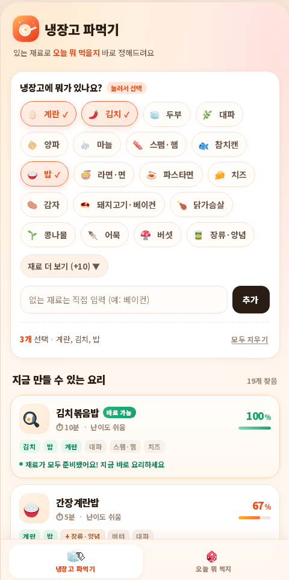

# 🍳 냉장고 파먹기 · 오늘 뭐 먹지

냉장고에 있는 재료만 골라도 **지금 만들 수 있는 요리**를 찾아주고,
오늘 뭐 먹을지 못 정했을 때는 **룰렛**으로 메뉴를 정해주는 모바일 웹앱입니다.

👉 **바로 쓰기: <https://chae7549-stack.github.io/what-to-eat-today/>**

<p align="center">
  
  
</p>

- 설치 없이 브라우저에서 바로 열립니다.
- iPhone·Android 홈 화면에 추가하면 앱처럼 전체 화면으로 실행됩니다(PWA).
- **57가지 메뉴**(집밥 42 · 배달·외식 15) · 29가지 재료 · 요리별 3~4단계 레시피 수록.

---

## 주요 기능

### 🧊 1. 냉장고 파먹기 (재료 매칭)

- 계란, 김치, 두부, 대파, 양파, 마늘, 스팸·햄, 참치캔, 밥, 라면, 파스타면, 치즈,
  감자, 돼지고기, 닭가슴살, 콩나물, 어묵, 버섯, 장류·양념 등 **29가지 재료 칩**을 눌러 선택
- 목록에 없는 재료는 **직접 입력**(예: 베이컨, 다진 마늘 → 자동으로 기존 재료와 연결)
- 보유 재료 기준 **매칭률(%)** 순으로 요리 정렬, `바로 가능` 배지 표시
- 부족한 재료를 `+ 대파`처럼 표시해서 **딱 무엇만 사면 되는지** 한눈에 보여요
- 요리를 누르면 **재료 체크리스트 + 3~4단계 레시피 + 팁** 드로어가 열립니다
- 선택한 재료는 브라우저에 저장되어 다시 열어도 유지됩니다

### 🎲 2. 오늘 뭐 먹지? (룰렛)

- 필터 3종
  - **상황·기분**: 아무거나 / 혼밥 / 든든한 한끼 / 야식 / 해장 / 가벼운 식단
  - **예산**: 상관없음 / 1만원 이하 / 1~2만원
  - **방식**: 전체 / 집에서 만들기 / 배달·외식
- 필터에 맞는 후보만 남기고 **룰렛 애니메이션**으로 한 가지 메뉴를 뽑아줍니다
- 결과 카드에서 **다시 돌리기 · 공유하기 · 레시피(주문 팁)** 바로 실행
- 공유 문구 예시: `오늘 메뉴는 김치볶음밥 당첨! 🍳`

### 📤 공유

- **Web Share API** 우선 사용(아이폰·안드로이드 기본 공유 시트)
- 지원하지 않는 환경에서는 **클립보드 복사**로 자동 폴백

### 📱 PWA

- `manifest.webmanifest` + iOS 메타 태그(`apple-mobile-web-app-capable` 등)
- 마스커블 아이콘, 애플 터치 아이콘, SVG 파비콘 포함
- 서비스 워커(`sw.js`)로 앱 껍데기를 캐시 → **오프라인에서도 실행**

---

## 홈 화면에 추가하는 방법

| 기기 | 방법 |
| --- | --- |
| **iPhone (Safari)** | 공유 버튼 → **홈 화면에 추가** |
| **Android (Chrome)** | 우측 상단 ⋮ → **앱 설치** / **홈 화면에 추가** |
| **데스크톱 (Chrome/Edge)** | 주소창 오른쪽 설치 아이콘 |

설치하면 주소창 없이 전체 화면으로 열리고, 마지막에 보던 화면과 고른 재료가 그대로 남습니다.

---

## 파일 구조

```
what-to-eat-today/
├── index.html              # 화면 구조 (모드 1·2, 드로어, 광고 슬롯 주석)
├── styles.css              # 모바일 퍼스트 스타일 (480px 카드 레이아웃)
├── app.js                  # 재료·요리 데이터 + 매칭/룰렛/공유 로직
├── manifest.webmanifest    # PWA 매니페스트
├── sw.js                   # 서비스 워커 (오프라인 캐시)
├── icons/                  # SVG·PNG 아이콘 (192, 512, maskable, apple-touch)
├── docs/                   # README용 스크린샷
└── tools/
    ├── make_icons.py       # 아이콘 PNG 생성 스크립트
    ├── check_logic.py      # 요리 데이터·매칭·룰렛 로직 점검
    └── check_app.py        # 실제 브라우저(iPhone 크기) 동작·스크린샷 점검
```

- 외부 라이브러리·CDN·폰트 의존성 **없음** (단일 정적 파일 구성, 빠른 로딩)
- `index.html` 하나만 열어도 동작합니다(로컬 `file://` 포함).

### 요리 추가하기

`app.js`의 `DISHES` 배열에 항목을 추가하면 목록·룰렛·레시피에 자동 반영됩니다.

```js
{
  id: "my-dish",
  name: "요리 이름",
  emoji: "🍲",
  time: 15,                       // 조리 시간(분)
  level: 1,                       // 1: 쉬움, 2: 보통
  req: ["egg", "rice"],           // 필수 재료 id
  opt: ["pa", "cheese"],          // 있으면 좋은 재료
  moods: ["alone", "hearty"],     // alone·hearty·night·hangover·light
  budget: "low",                  // low·mid·high
  method: "home",                 // home(집에서) · out(배달·외식)
  steps: ["1단계", "2단계", "3단계"],
  tip: "한 줄 팁",
  comment: "룰렛 결과에 나올 한마디",
}
```

---

## 수익화(광고) 준비

`index.html`의 **광고 슬롯 주석** 위치에 AdSense 또는 카카오 AdFit 코드를 넣으면 됩니다.
자리(`#adSlot`, `.ad-slot`)와 스타일은 이미 준비되어 있고, 지금은 `hidden` 상태입니다.

```html
<!-- Google AdSense 예시 -->
<div class="ad-slot">
  <ins class="adsbygoogle" style="display:block"
       data-ad-client="ca-pub-XXXXXXXXXXXXXXXX"
       data-ad-slot="0000000000"
       data-ad-format="auto" data-full-width-responsive="true"></ins>
</div>
```

- 광고는 본문과 구분되도록 `AD` 라벨을 붙여 주세요.
- 커스텀 도메인을 연결하면 `manifest.webmanifest`의 `start_url`·`scope`만 그대로 두어도 동작합니다.

---

## 개발 메모

- 순수 HTML/CSS/JavaScript(ES5 호환 문법) — 빌드 과정 없음
- iPhone Safari의 안전 영역(`env(safe-area-inset-bottom)`) 대응, 탭 영역 최소 44px
- `prefers-reduced-motion` 환경에서는 애니메이션 최소화
- 접근성: 재료 칩 `aria-pressed`, 드로어 `role="dialog"`, 결과 영역 `aria-live`

## 라이선스

개인 프로젝트 · 자유롭게 사용하세요. (MIT)
